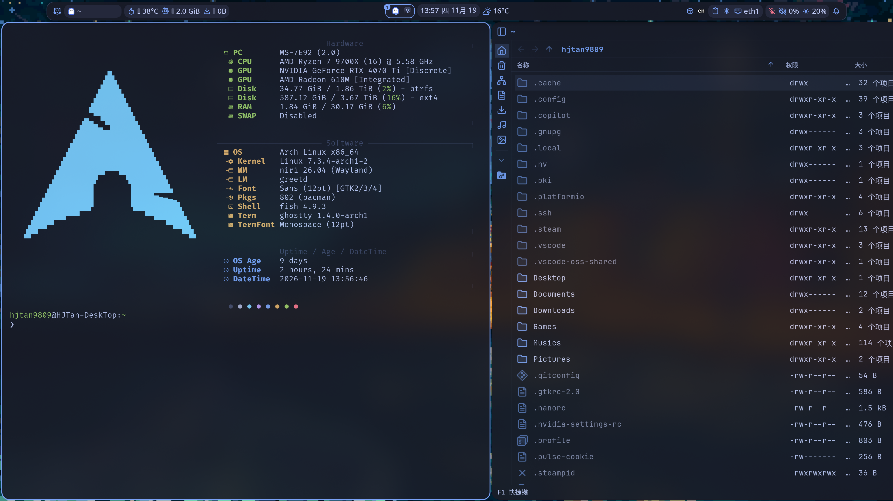

# arch minim install Niri+Noctalia setup script



It's recommended to use archinstall's minimal+network+limine+btrfs installation(Btrfs recommends creating at least two subvolumes, for mounting the root directory and /swap). After installing, run arch_init.sh, then run outputs_set.sh after reboot.

## arch_init

This script will install some necessary software and set up system configurations like limine-Btrfs snapshots, and finally, you can optionally install third-party software. And for Chinese users, set the Chinese font family and install kmscon,fcitx5 (determined through the ```$LANG``` environment variable).

## outputs_set

This script gets the output device resolution through ```niri msg outputs```, updates niri and xwayland display settings, as well as the font size in the limine boot interface, and for Chinese users, it also updates the font size in kmscon.

